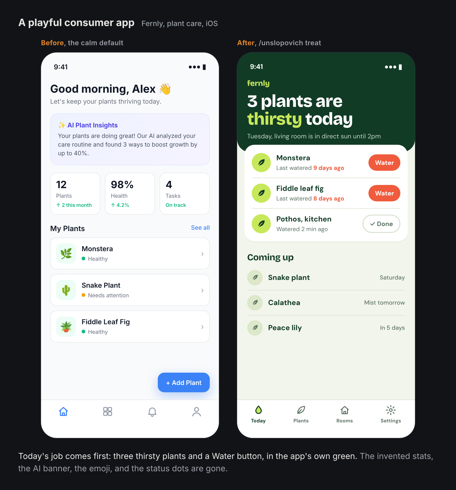
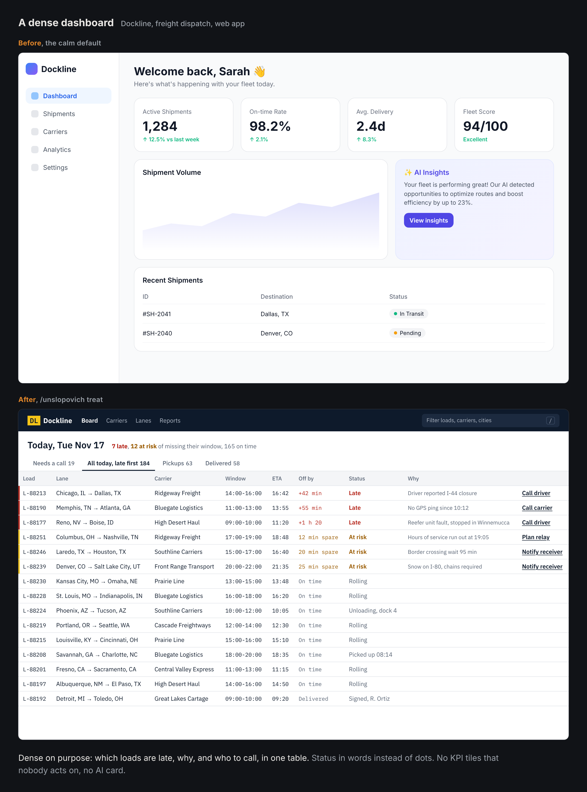
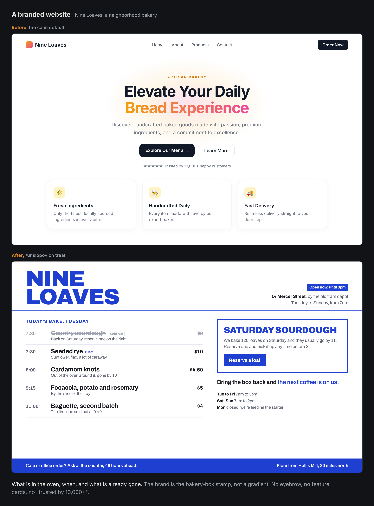

<p align="center">
  
</p>

<h1 align="center">unslopovich</h1>

<p align="center"><em>Your app looks AI-generated. Dr. Unslopovich noticed.</em></p>

<p align="center"><em>Users don't hate your purple gradient. They hate what you did to the back button.</em></p>

<p align="center">
  <a href="https://www.npmjs.com/package/unslopovich"></a>
  <a href="#install"></a>
  <a href="https://github.com/erkamyaman/unslopovich/actions/workflows/test.yml"></a>
  
  <a href="LICENSE"></a>
  <a href="https://github.com/erkamyaman/unslopovich"></a>
</p>

<p align="center">5,008,684 app reviews read · 1 purple gradient found · 31 detector rules · one command</p>

<p align="center"><a href="research/README.md">The study behind it</a>: what people actually complain about, with the method and the code.</p>


<sub>Dramatization. Your app may be worse.</sub>

```bash
npx unslopovich
```

Then tell your agent:

```text
/unslopovich review my app
```

Works in Claude Code, Codex, Cursor, OpenCode, Gemini CLI, and GitHub Copilot ([install options](#install)). Mobile apps, web apps, and websites. Same doctor, different reflexes: on a phone it checks you didn't build a website, and on the web it checks you didn't break one.

## A real run

We ran it on [QuizHub](https://github.com/ramkrishnajha5/QuizHub), an open-source quiz app, and changed nothing by hand:


Score 10 to 18 out of 24. Detector findings on this screen 39 to 0. It also found that when the topic list fails to load, the screen showed an empty dropdown and a dead button and said nothing. Now it says so and offers Try again. [The report and the diff.](docs/examples/quizhub/)

<sub>The sandbox blocked the app's database, so both sides show the same sample data.</sub>

## Same doctor, three patients

The purple gradient above is the easy case. The harder one is the calm default today's models reach for: white cards, gray borders, one blue accent, a stat row, an AI banner. It looks fine, and it looks like every other app. The doctor treats that too, and the result should look like *your* app, whatever your style is.







<sub>Illustrations of what a treatment aims for, drawn by hand from the skill's rules. The apps are made up.</sub>

## The doctor did the reading

Dr. Unslopovich read 5,008,684 reviews of 7,786 apps on the App Store and Google Play. "Gradient" came up 163 times, mostly from people asking for one. "Purple gradient" came up once, in a 2-star review asking Copilot to bring its blue and purple gradients back.

Here's what the 2,072,794 reviews rated 3 stars or lower complained about instead:

| | App Store | Google Play |
|---|---|---|
| **It's broken.** Something just doesn't work | 35% | 35% |
| **Nobody helps.** Support, refunds, scams | 22% | 20% |
| **The business behind it.** Late deliveries, unfair games, bad drivers | 18% | 21% |
| **It costs too much.** Paywalls, subscriptions, surprise charges | 20% | 18% |
| **Can't get in.** Login, verification codes, locked accounts | 11% | 11% |
| **You interrupted them.** Ads and popups mid-task | 9% | 12% |
| **You hid everything.** Hard to find or use | 9% | 7% |
| **You moved the button.** A redesign moved or removed something | 7% | 5% |
| **You made it slow.** Lag, freezing, battery | 5% | 6% |
| **It crashed.** | 5% | 4% |
| **You put AI where the feature was.** | 2% | 1% |
| **You never tried it on their phone.** Broken layouts | 1% | 1% |

About a quarter of complaints (26% on the App Store, 24% on Google Play) are things a design and front-end pass can fix. Crashes, lag, and bugs together are 41% on both.

<sub>A random sample of 1,200 low-rated reviews, each read and labelled against written definitions; a review can name several problems. Rounded; 95% intervals are about ±3 to 4 points for the big themes. [The whole method, code, and limits.](research/README.md)</sub>

And the 4-star reviews, from people who mostly like the app? 87% of them on the App Store and 61% on Google Play still name a problem. It's a different list:

| | App Store | Google Play |
|---|---|---|
| **Add this.** A feature they want | 30% | 12% |
| **It's broken.** | 25% | 18% |
| **The business behind it.** | 15% | 15% |
| **It costs too much.** | 12% | 7% |
| **You hid everything.** | 11% | 5% |
| **Nobody helps.** | 2% | 1% |

Support and account trouble mostly drop out. What's left is "add this" and "this is broken". A design pass would fix 20% (App Store) and 12% (Google Play) of them.

<sub>A second random sample of 300 4-star reviews, 150 per store, labelled the same way. Smaller, so intervals are about ±5 to 7 points.</sub>

So the doctor checks what users actually scream about first, and your gradient second.

The biggest bucket is the one no design review can see: you can't read a bug or lag off a screenshot. The doctor flags what code gives away, like lists that render every row up front, and every report says **Not profiled** until someone actually profiles it. A clean review is not a clean bill of health.

## Symptoms

- Controls that moved, vanished, or do nothing
- AI features blocking the thing people came to do
- Numbers and labels that lie
- Website in a phone: hamburger menus, hero sections, fake tab bars
- Cards inside cards inside cards
- The tasteful default: white cards, thin gray borders, one blue accent, a colored dot beside every label
- Emoji pretending to be icons
- Stat tiles with numbers nobody measured
- The keyboard sitting on top of the input
- "Oops! Something went wrong"
- "Unlock your potential"

## Appointments

```text
/unslopovich review the home screen     diagnosis and a score out of 24, no edits
/unslopovich treat checkout             diagnose, fix, verify, before and after
/unslopovich scan src/                  quick code-only pass with the detector
/unslopovich chart                      write down your top tasks and brand rules once
/unslopovich follow-up home             re-check and compare with the last visit
```

The chart lives in `.unslopovich/chart.md`. It's where you tell the doctor that the gradient is the brand, so it stops bringing it up.

## The detector

Thirty-one rules that read SwiftUI, UIKit, Compose, Android XML, React Native, Flutter, Ionic, React, Vue, Svelte, Astro, HTML, CSS, and Tailwind classes. No model, no network, no dependencies. The skill runs it for you, and it works on its own too:

```bash
npx unslopovich detect src/
npx unslopovich detect --json ios/ android/   # for agents and CI
npx unslopovich detect --list-rules           # every rule and its fix
```

It catches purple gradients and the project template's leftover purple, nested cards, decorative status dots, gradient text, glow shadows, emoji icons, unvirtualized lists, text that ignores the user's font size, disabled back gestures, hamburger menus, hover in a touch app, keyboards covering inputs, invented stats, and "Oops! Something went wrong".

On the web it adds clickable divs, removed focus rings, disabled zoom, images without alt text, tracked-caps eyebrows, icons in tinted squares, `transition-all`, cards that grow on hover, things that pulse forever, and "Trusted by 10,000+ teams".

It reads the nearest `package.json` to tell a phone app from a website, so hover is a problem in your Expo app and fine on your Next.js site. `--platform web` or `--platform mobile` settles it when it guesses wrong.

Exit code `2` means findings, so it can gate a pull request. Silence one line with `// unslopovich-ignore <rule-id>` (`<!-- unslopovich-ignore <rule-id> -->` in XML), or a whole rule in `.unslopovich/config.json`:

```json
{ "ignoreRules": ["status-dot"], "ignorePaths": ["src/legacy/"] }
```

It reads code, not screens. Most of what users complain about, a moved button, a popup in the way, a slow list, only shows up in the running app, which is why the skill looks at that first.

## Bedside manner

> Three gradients, two hamburgers, no back button. I have questions.

> This card contains a card. That card contains a sparkle. Remove all three.

> "Seamless" is not a feature.

Sample verdicts. Yours may be worse.

## Treats

**Mobile:** SwiftUI, UIKit, Jetpack Compose, React Native, Expo, Flutter, Ionic, Capacitor, Angular Native, and NativeScript.

**Web:** React, Next.js, Vue, Nuxt, Svelte, Astro, Angular, and plain HTML and CSS, Tailwind and shadcn/ui included.

It reads your theme, finds the problems, fixes the shared components first, and uses your platform's native building blocks. It won't move your users' favorite button without asking.

It also won't trade your purple gradient for the other default, the calm white one every model reaches for. A treated screen has to pass one test: cover the logo, and it should still look like your app.

Before a big change it tells you how sick the patient is (heavy, light, or healthy) and writes a five-line direction for you to approve. Healthy screens get told they're healthy and left alone.

Only want the bad news? Ask for a review and it stops at the diagnosis.

## Prior art

The doctor trained under good people. [Impeccable](https://github.com/pbakaus/impeccable) by Paul Bakaus showed that a deterministic detector and design vocabulary beat a longer prompt. [Hallmark](https://github.com/Nutlope/hallmark) by Together AI showed the value of a floor that never bends, defaults you can only waive on the record, and a fresh-eyed reviewer at the end. [Unslop](https://github.com/heydamir/unslop) by Damir Sokolovsky ([@heydamir](https://x.com/heydamir)) showed that deciding how much to change comes before changing anything, and that richness belongs in the content, not the chrome. Unslopovich is for the screens they leave to others: native mobile apps, and the parts of a web app people use every day.

## Install

```bash
npx unslopovich
```

The installer finds the coding agents on your machine and installs for each one. Needs Node 18 or later.

| Agent | Installed to | Then type |
|---|---|---|
| Claude Code | `~/.claude/skills/unslopovich` | `/unslopovich review my app` |
| Codex | `~/.agents/skills/unslopovich` | `$unslopovich review my app` |
| Cursor | `~/.agents/skills/unslopovich` (Cursor reads it there) | `/unslopovich review my app` |
| OpenCode | `~/.agents/skills/unslopovich` (OpenCode reads it there) | `/unslopovich review my app` |
| Gemini CLI | `.gemini/skills/unslopovich`, per project | `/unslopovich review my app` |
| GitHub Copilot | `.github/skills/unslopovich`, per project | `/unslopovich review my app` |

Or just ask in your own words ("review my app for AI slop") and the agent picks the skill up.

- **Some agents only:** `npx unslopovich --agent codex,cursor` (any of `claude`, `codex`, `cursor`, `opencode`, `gemini`, `copilot`)
- **One project, for the whole team:** run `npx unslopovich --project` in the project and commit the folder it creates
- **Any other agent that reads `SKILL.md`:** `npx unslopovich --dir path/to/its/skills`
- **As a Claude Code plugin:** `/plugin marketplace add erkamyaman/unslopovich`, then `/plugin install unslopovich@unslopovich`
- **As a Codex plugin:** `codex plugin marketplace add erkamyaman/unslopovich`, then `codex plugin add unslopovich@unslopovich`
- **With the open skills installer:** `npx skills add erkamyaman/unslopovich`
- **By hand:** copy `skills/unslopovich` from this repo into your agent's skills folder

The skill is `SKILL.md`, a `reference/` folder it reads on demand, and the detector in `scripts/`.

## Update or remove

Run `npx unslopovich` again to update. As a plugin, `/plugin marketplace update unslopovich` in Claude Code or `codex plugin marketplace upgrade` in Codex.

To remove it, delete the `unslopovich` folder from your agent's skills folder (the table above says where), or `/plugin uninstall unslopovich@unslopovich` and `codex plugin remove unslopovich@unslopovich`. It leaves only `.unslopovich/` in your project, if you made a chart.

## What it won't do

- **It can't see your app run.** The detector reads code. The skill looks at screens when your agent can open them, and says so when it couldn't.
- **It can't profile.** Lag and battery need a real device and a profiler. Reports say **Not profiled**.
- **It won't fix your bugs.** The biggest complaint in the study is "it's broken". That's your test suite's job.
- **Taste is still taste.** The rules come from reviews and platform guidelines, but the final call on how your app looks is yours. Write it in the chart.

If something it flags is wrong, [open an issue](https://github.com/erkamyaman/unslopovich/issues) with the line. False positives get fixed first.

Want to hear when a new version is out? Star the repo, then **Watch → Custom → Releases**.

## License

MIT © [Erkam Yaman](https://github.com/erkamyaman)

If it saved you a redesign, you can [sponsor me](https://github.com/sponsors/erkamyaman).
